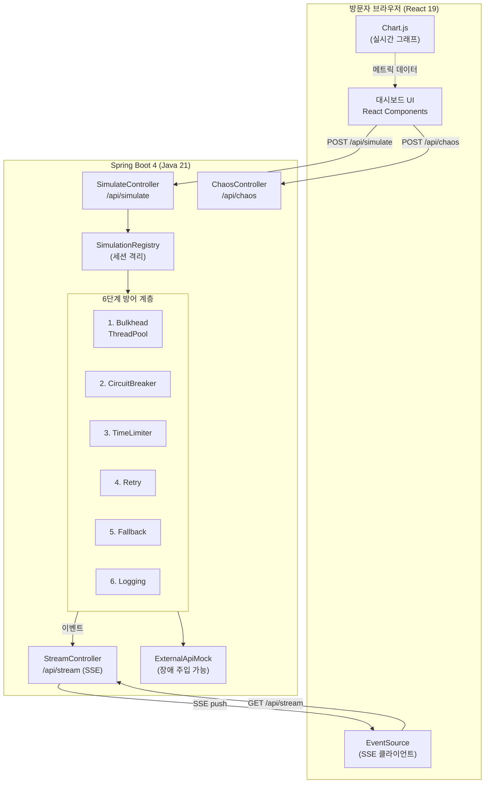
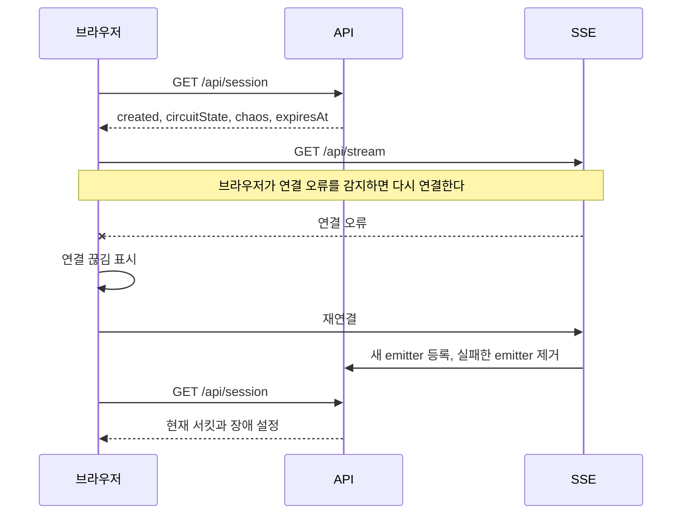
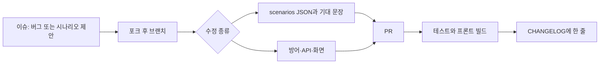

# Resilience4j Playground

> 외부 API 장애를 브라우저에서 직접 주입하고, Resilience4j 6단계 방어 전략이 실시간으로 반응하는 모습을 눈으로 확인하는 오픈소스 풀스택 웹 데모.

[](https://github.com/yourname/resilience4j-playground/actions)
[](LICENSE)
[](https://openjdk.org/projects/jdk/21/)
[](https://spring.io/projects/spring-boot)
[](https://react.dev/)

외부 시세 API가 느려지거나 죽어도 화면이 어떻게 버티는지, 가입 없이 브라우저에서 직접 부숴 본다.

공개 주소에서는 1분 안에 빨간 불과 대체 가격 4500을 본다. 로컬은 `docker compose up` 뒤 `http://localhost:8080`이다. 처음이면 **3분 체험**만 누르면 된다. 이미 서킷을 다뤄 봤으면 **직접 조작**으로 지연, 에러율, 재시도 순서를 바로 바꾼다.

이 아래는 설계 문서다. 구현 제약은 [`.cursor/rules/`](.cursor/rules/), 사람을 모으는 순서는 [28장](#28-쓰이게-만드는-전략)에 있다.

## 문서 언어

이 파일이 한국어 기본 문서다. 영문 페이지는 아직 없다. 나중에 같은 구성의 영문 페이지를 `readme.en.md`로 작성한다. 화면 문구의 영어 번역은 그 파일과 따로 두며, [26장](#26-확장-범위)의 영어 맵 슬롯을 따른다.

## 목차

1. [왜 이 프로젝트를 만드는가](#1-왜-이-프로젝트를-만드는가)
2. [이 프로젝트로 어필하려는 것](#2-이-프로젝트로-어필하려는-것)
3. [기술 스택](#3-기술-스택)
4. [아키텍처](#4-아키텍처)
5. [6단계 방어 전략 상세](#5-6단계-방어-전략-상세)
6. [Aspect Order](#6-aspect-order-매우-중요)
7. [세션 격리 설계](#7-세션-격리-설계)
8. [SSE 실시간 이벤트](#8-sse-실시간-이벤트)
9. [Gradle 빌드 설정](#9-gradle-빌드-설정-백엔드)
10. [React 프로젝트 구조](#10-react-프로젝트-구조)
11. [React 컴포넌트 설계](#11-react-컴포넌트-설계)
12. [API 명세](#12-api-명세)
13. [`application.yml`](#13-applicationyml-전체)
14. [8GB RAM / 4 CPU 환경 최적화](#14-8gb-ram--4-cpu-환경-최적화)
15. [프로젝트 구조](#15-프로젝트-구조-전체)
16. [실행 방법](#16-실행-방법)
17. [AI 프롬프트 개발 가이드](#17-ai-프롬프트-개발-가이드)
18. [개발 로드맵](#18-개발-로드맵-권장-순서)
19. [체험 시나리오](#19-체험-시나리오-카탈로그)
20. [관측 계약](#20-관측-계약)
21. [방어 없음 vs 6단계](#21-방어-없음-vs-6단계)
22. [재시도, 멱등성, 비즈니스 예외](#22-재시도-멱등성-비즈니스-예외)
23. [저장소 구현 기준](#23-저장소-구현-기준)
24. [공개 전 체크리스트](#24-공개-전-체크리스트)
25. [사용자 흐름](#25-사용자-흐름)
26. [확장 범위](#26-확장-범위)
27. [유지와 보수](#27-유지와-보수)
28. [쓰이게 만드는 전략](#28-쓰이게-만드는-전략)
29. [라이선스](#29-라이선스)
30. [참고](#30-참고)

---

## 1. 왜 이 프로젝트를 만드는가

### 문제의식

실무에서 외부 API 호출은 언제든 느려지거나, 끊기거나, 500을 뱉는다. 방어 계층이 없으면:

- 외부 API의 지연이 **애플리케이션 전체 스레드를 고갈**시킨다.
- 장애가 **연쇄 전파**되어 정상 기능까지 멈춘다.
- 사용자는 **에러 화면**을 본다.

Resilience4j는 이 문제를 해결하는 사실상의 표준이지만, 문서를 읽는 것과 **실제로 동작하는 모습을 보는 것**은 완전히 다르다. 서킷이 언제 열리는지, 재시도와 서킷의 순서가 실패 카운트에 어떤 영향을 주는지, 지터가 없으면 어떤 일이 생기는지는 **직접 재현하고 관측해야** 체득된다.

### 이 프로젝트가 하는 일

방문자가 URL에 접속하면:

1. **장애 주입 슬라이더**로 외부 API의 지연·에러율을 조절한다.
2. **“채소 시세 조회” 버튼**을 누른다.
3. 요청이 6단계 방어 계층을 통과하는 과정이 **실시간 애니메이션**으로 표시된다.
4. 서킷이 OPEN되면 화면에 빨간불이 들어오고, **폴백 4500**이 즉시 반환된다.
5. 10초 뒤 HALF_OPEN → CLOSED로 **자동 복구**되는 모습을 지켜본다.
6. 우측 그래프에 p50/p99, 에러율, 폴백 비율이 실시간으로 갱신된다.

**코드를 한 줄도 짜지 않고, 버튼 몇 번으로 6가지 전략을 체험한다.**

---

## 2. 이 프로젝트로 어필하려는 것

### 2.1 “실무에서 했다” 대신 “직접 만들어서 검증했다”

면접에서 “Resilience4j 실무 경험 있습니다”라고 말하면 꼬리 질문에 무너진다. 대신 이 프로젝트는:

> “실무 운영 경험은 아직 없지만, Resilience4j 방어 전략을 직접 체험하는 오픈소스 풀스택 웹 데모를 만들었습니다. 서킷 상태 전환을 SSE로 실시간 시각화하고, 재시도와 서킷의 aspect order가 실패 카운트에 미치는 영향을 직접 실험했습니다.”

라고 **검증 가능한 형태**로 말할 수 있게 한다. GitHub 링크 하나로 모든 것이 증명된다.

### 2.2 어필하는 역량

| 역량 | 증명 방법 |
|------|----------|
| **백엔드 설계** | Spring Boot 4, Resilience4j 6단계, 세션 격리, SSE |
| **프론트엔드 설계** | React 19, 컴포넌트 분리, 커스텀 훅, Chart.js |
| **실시간 통신** | SSE + EventSource, 재연결 처리 |
| **관측 가능성** | Actuator + Micrometer + 실시간 메트릭 |
| **Java 21 / Spring Boot 4** | Virtual Threads, SseEmitter, Jakarta EE 11 |
| **Gradle 빌드** | 프론트 빌드 통합, Kotlin DSL |
| **오픈소스 운영** | 시나리오 파일로 실험을 추가, 이벤트 `schemaVersion`, CONTRIBUTING, CI |
| **공개 데모 운영** | 세션 상한, 설정 키 화이트리스트, 배포 프로필에서 Actuator 축소 |
| **자원 최적화** | 8GB RAM, 4 CPU 환경에서 JVM + Node 튜닝 |

### 2.3 면접 예상 꼬리 질문과 답변 포인트

- **“서킷이 HALF_OPEN에서 다시 OPEN으로 돌아가나요?”** → 테스트 호출이 실패하면 다시 OPEN. `permittedNumberOfCallsInHalfOpenState` 설정값과 실제 동작을 프로젝트에서 확인한 경험으로 답변.
- **“Retry와 CircuitBreaker 순서를 바꾸면 뭐가 달라지나요?”** → 기본은 Retry가 바깥. 각 재시도가 서킷에 개별 기록되어 실패율이 부풀려질 수 있음. 프로젝트에서 aspect order를 바꿔가며 비교한 결과로 답변.
- **“지터를 넣으면 실제 대기 시간 분포가 어떻게 되나요?”** → `randomizedWaitFactor=0.5`이면 ±50% 범위. 프로젝트에서 지터 on/off 토글로 분포 변화를 시각화한 경험으로 답변.
- **“ThreadPoolBulkhead와 SemaphoreBulkhead는 언제 각각 쓰나요?”** → 블로킹 I/O는 ThreadPool, CPU-bound는 Semaphore. 프로젝트에서 두 가지를 토글로 비교한 경험으로 답변.
- **“SSE와 WebSocket 중 왜 SSE를 선택했나요?”** → 단방향 서버→클라이언트 푸시만 필요, HTTP/2 위에서 동작, 자동 재연결 내장, WebFlux 불필요. 프로젝트에서 EventSource로 구현한 경험으로 답변.
- **“여러 방문자가 동시에 접속하면 서로 영향 없나요?”** → 세션별 독립 서킷 인스턴스. `SimulationRegistry`가 `sessionId` 기반으로 관리. 프로젝트에서 두 브라우저로 확인한 경험으로 답변.
- **“슬로우 콜과 에러는 뭐가 다른가요?”** → 응답은 성공인데 느린 호출은 `slowCallRateThreshold`로, 예외는 `failureRateThreshold`로 집계된다. 지연만 올리고 에러율은 0으로 둔 실험과, 지연은 0이고 에러율만 올린 실험을 나눠 보여 준다.
- **“비즈니스 예외도 서킷을 여나요?”** → 품절처럼 예상된 도메인 예외는 `ignoreExceptions`에 넣어 실패율에서 제외한다. 네트워크 오류와 타임아웃만 실패로 기록한다.
- **“재시도해도 되는 호출인가요?”** → 채소 시세 조회는 읽기라 재시도가 안전하다. 부수 효과가 있는 쓰기라면 멱등 키가 먼저다. 데모 API를 읽기로 둔 이유까지 같이 말한다.
- **“운영에 그대로 올릴 수 있나요?”** → 단일 프로세스, 힙 안 세션, 목 API다. 분산 서킷, 실제 TCP 장애, 재시작 이후 상태 복원은 범위 밖이다. 한계를 먼저 말하면 설계 범위를 이해하고 있다는 증거가 된다.
- **“공개 URL로 띄우면 무엇을 막았나요?”** → 장애 주입은 자기 `sessionId`만 바꾼다. 서킷 설정은 허용된 키와 범위만 받는다. 활성 세션 수에 상한이 있다. 배포 프로필은 `health`만 열고 Prometheus는 닫는다. 실험 리포트는 서버에 저장하지 않는다.
- **“다른 사람이 실험을 추가하려면?”** → `scenarios/`의 JSON 하나와 기대 결과 문장이다. 방어 계층 코드를 수정하는 PR과 시나리오를 추가하는 PR은 나뉜다.

### 2.4 이력서와 공개 프로필에 쓸 문장

숫자를 지어내지 않는다. 아래 문장은 구현과 실험이 끝난 뒤에만 이력서에 붙인다. 측정값은 데모에서 나온 실제 숫자로 바꾼다.

**한 줄**

> 외부 API 장애를 브라우저에서 주입하고, Resilience4j 방어 계층의 상태 전이를 SSE로 보여주는 풀스택 데모를 설계하고 구현했다.

**불릿**

- 세션마다 서킷, 벌크헤드, 장애 설정을 분리해 방문자 한 명의 실험이 다른 방문자의 화면에 섞이지 않게 했다.
- Retry가 CircuitBreaker 바깥에 있을 때 재시도가 실패율 창에 중복 기록되는 현상을 aspect order 비교 실험으로 재현하고, `CallNotPermittedException`이 재시도를 소모하지 않도록 제외했다.
- 같은 장애 조건에서 방어 없는 경로와 6단계 경로의 지연, 폴백 비율, 동시 처리 한도를 나란히 보여 주었다.
- 시나리오 링크 하나로 같은 실험을 재현하게 하고, 이벤트에 `schemaVersion`을 두어 화면과 서버 계약이 어긋나면 조용히 무시하지 않게 했다.
- 실패율과 슬로우 콜을 다른 슬라이더로 나눠, 성공이지만 느린 호출과 예외가 서킷을 여는 조건이 다름을 화면에서 확인하게 했다.

**영문 (GitHub / LinkedIn)**

> Built a full-stack playground that injects latency and error rate into a mocked upstream call and streams Resilience4j bulkhead, circuit breaker, time limiter, retry, and fallback transitions to the browser over SSE. Circuit state, bulkhead permits, and chaos settings are isolated per browser session. A side-by-side naive path shows what changes when the same fault hits an unprotected call.

### 2.5 5분 면접 데모

말로 설명하기 전에 이 순서대로 화면을 보여 준다. 각 장면은 [19장 시나리오](#19-체험-시나리오-카탈로그)의 번호와 연결된다.

| 시각 | 화면에서 하는 일 | 말로 남기는 한 문장 |
|------|------------------|---------------------|
| 0:00 | 대시보드를 열고 서킷이 CLOSED임을 가리킨다 | 외부 시세 API가 느려지거나 죽을 때 사용자에게 무엇을 돌려줄지 실험하는 화면이다 |
| 0:30 | 방어 없는 조회로 지연 5초를 건다 (S1) | 방어가 없으면 호출 스레드가 그 지연을 그대로 안고 간다 |
| 1:20 | 6단계 조회로 바꾼다. 3초 타임아웃 후 폴백 4500 (S2) | 사용자는 5초를 기다리지 않고, 어제 단가를 받는다 |
| 2:10 | 에러율 60%로 조회를 반복해 OPEN을 만든다 (S3) | 이후 호출은 외부로 나가지 않는다. 로그의 `upstreamCalls`가 0이다 |
| 3:00 | 10초를 기다려 HALF_OPEN, 이어서 CLOSED (S4) | 복구는 타이머와 시험 호출로 일어난다. 시험 호출이 실패하면 다시 OPEN이다 |
| 3:40 | 브라우저 두 개로 세션을 나눈다 (S5) | 이쪽 에러율은 저쪽 서킷을 열지 않는다 |
| 4:20 | aspect order 또는 지터 토글을 한 번만 보여 준다 (S6, S7) | 재시도 횟수와 서킷 실패 횟수는 같은 숫자가 아니다 |

데모 전에 장애 슬라이더를 0으로 되돌리고, 이벤트 로그를 비운다. 실험 도중 숫자를 외우려고 하지 않고, 화면의 `attempts`와 `upstreamCalls`를 가리킨다.

### 2.6 검증 가능한 주장

면접에서 말할 문장은 테스트나 화면 중 하나에 대응해야 한다.

| 주장 | 증거 |
|------|------|
| 실패율이 임계값을 넘으면 OPEN이 된다 | `CircuitBreakerTest`, 시나리오 S3 |
| 성공이지만 느린 호출만으로도 OPEN이 될 수 있다 | 시나리오 S8, `slowCallRateThreshold` |
| HALF_OPEN 시험 호출이 실패하면 다시 OPEN이다 | `CircuitBreakerTest`, 시나리오 S4 |
| 세션 A의 장애 설정은 세션 B의 서킷과 무관하다 | `SimulationRegistryTest`, 시나리오 S5 |
| 타임아웃이면 폴백이 반환되고 실행 중 Future는 취소된다 | `VeggieServiceTest`, 시나리오 S2 |
| OPEN 이후 `CallNotPermittedException`은 재시도 횟수를 소모하지 않는다 | 이벤트 로그의 `attempts`, 시나리오 S3 |
| 논리적 1회 실패가 서킷에는 재시도 횟수만큼 기록될 수 있다 | aspect order 비교, 시나리오 S6 |
| 지터가 있으면 같은 설정의 대기 시간이 퍼진다 | `waitMs` 분포, 시나리오 S7 |
| 동시 요청은 풀 크기와 큐를 넘는 순간 거절된다 | 시나리오 S9 |
| 품절은 서킷 실패율에 넣지 않는다 | `UnknownVeggieException` + `ignoreExceptions`, 시나리오 S10 |

측정하지 않은 항목은 이력서 문장에 넣지 않는다. “p99가 480ms”처럼 README 예시 JSON에 있는 숫자는 샘플이다.

### 2.7 설계 결정

| 결정 | 선택한 것 | 그렇게 한 이유 | 감수하는 것 |
|------|-----------|----------------|-------------|
| 실시간 채널 | SSE (`SseEmitter` + `EventSource`) | 서버에서 브라우저로만 흐르면 된다. 재연결이 브라우저에 있다. WebFlux 없이도 된다 | 브라우저에서 서버로 보내는 제어는 일반 HTTP로 따로 둔다 |
| 웹 스택 | Spring MVC | 8GB 장비에서 서블릿과 가상 스레드 비교가 충분하다 | 스트림 합성, 백프레셔는 WebFlux 쪽이 표현력이 크다 |
| 장애 주입 | 프로세스 안 목 (`ExternalApiMock`) | 슬라이더가 곧 지연과 에러율이다. 데모에 별도 프록시 프로세스가 필요 없다 | 실제 DNS, TLS, 커넥션 리셋은 재현하지 못한다 |
| 격리 단위 | `sessionId`마다 서킷, 벌크헤드, 목 설정 | 공개 URL에서 방문자끼리 실험이 섞이면 데모가 성립하지 않는다 | 인스턴스가 방문자 수만큼 늘어 힙을 쓴다. 30분 만료로 회수한다 |
| 장애 API | 세션 스코프 | 전역 지연 설정은 다른 방문자의 실험을 망가뜨린다 | 클라이언트가 `sessionId`를 모든 변경 요청에 실어야 한다 |
| 기본 벌크헤드 | `ThreadPoolBulkhead`, 가상 스레드 프로필은 별도 | 풀이 가득 찬 모습을 스레드 수로 보여줄 수 있다 | 블로킹 호출에 플랫폼 스레드를 쓴다. 가상 스레드 비교는 프로필로 남긴다 |
| 슬라이딩 윈도 | `COUNT_BASED`, 크기 10 | 클릭 몇 번으로 OPEN을 만들 수 있다 | 시간 창 기반 운영 설정과는 감이 다르다. 라이브 편집으로 창 크기를 바꿀 수 있게 둔다 |
| 6단계의 마지막 | Logging을 화면 단계로 포함 | 폴백 이후에도 원인을 남기는 것이 방어의 일부다 | Resilience4j 데코레이터 5개와 UI 단계 6개의 개수가 다르다. 화면에서 그 차이를 숨기지 않는다 |
| RateLimiter | 기본 파이프라인에 넣지 않음 | 동시성 한도는 벌크헤드가 이미 보여 준다. 한 화면에 한도 두 개가 있으면 어느 쪽이 거절했는지 흐려진다 | “왜 레이트 리미터는 없나요?”에는 이 표로 답한다. 이후 토글로 추가할 여지는 남긴다 |
| 폴백 캐시 | 프로세스 로컬 마지막 성공 값 | Redis 없이 8GB 장비에서 기동된다 | 재시작과 다른 인스턴스에는 캐시가 없다 |
| 프론트 언어 | JavaScript | 이벤트 계약은 README와 SSE 스키마가 기준이다 | 컴파일 타임 타입 검사는 없다. 이벤트 필드 이름을 바꿀 때는 백엔드와 훅을 같이 고친다 |
| 요청 추적 | 호출마다 `requestId` | 애니메이션과 로그가 같은 호출을 가리켜야 aspect order 설명이 가능하다 | 분산 트레이싱 백엔드는 붙이지 않는다 |
| 실험 재현 | `scenarios/*.json`과 `/?scenario=` | 슬라이더 조작을 외우지 않아도 같은 장면을 연다. 기여자는 방어 코드를 건드리지 않고 실험을 추가한다 | 프리셋이 늘면 기대 결과 문장도 같이 늘린다 |
| 이벤트 호환 | 모든 응답·SSE에 `schemaVersion` | 필드를 추가할 때 기존 화면이 깨지지 않게 한다. 필드를 빼거나 의미를 바꾸면 버전을 올린다 | 화면은 모르는 이벤트 타입을 건너뛴다 |
| 실험 기록 | 브라우저에서 Markdown 저장 | 면접 첨부나 이슈 재현에 쓴다. 서버에 개인 실험 로그를 쌓지 않는다 | 그 브라우저가 받은 최근 100이벤트만 들어 있다 |
| 공개 배포 | 프로필별로 Actuator 노출을 나눔 | 로컬은 메트릭까지, 공개 URL은 `health`와 `info` | 공개 화면의 숫자는 세션 API와 SSE다. Prometheus를 방문자에게 열지 않는다 |

### 2.8 범위 밖과 한계

이 저장소가 증명하는 범위는 여기까지다.

- 서킷 상태는 프로세스 메모리다. 인스턴스가 둘 이상이면 서킷이 각각 열린다.
- 업스트림은 목이다. 패킷 유실, 느린 핸드셰이크, 부분 응답은 대상이 아니다.
- 세션과 마지막 성공 값은 재시작 시 사라진다.
- 화면의 p50, p99는 그 세션의 최근 호출 기준이다. Prometheus 히스토그램과 같은 정의가 아니다. 화면에 그 사실을 적는다.
- 인증은 없다. 공개 배포 시에도 장애 주입은 해당 `sessionId`만 바꾼다.
- RateLimiter, 분산 락, 메시지 큐 적재 폴백은 v1 동작이 아니다. 큐 적재 폴백을 고르면 `202`와 함께 “이 데모는 브로커에 넣지 않는다”는 표시를 반환한다.
- 계정, 데이터베이스, Redis, 메시지 브로커, 다중 인스턴스 서킷은 이후 버전에도 두지 않는다. 이유와 대안은 [26장](#26-확장-범위)에 있다.

---

## 3. 기술 스택

### 백엔드

| 계층 | 기술 | 버전 | 비고 |
|------|------|------|------|
| 언어 | Java | 21 (LTS) | Virtual Threads, ZGC |
| 프레임워크 | Spring Boot | 4.1.1 | Jakarta EE 11, Spring Framework 7 |
| 빌드 | Gradle | 8.14+ | Kotlin DSL |
| 방어 | Resilience4j | 2.4.0 | `resilience4j-spring-boot4` |
| 관측 | Actuator + Micrometer | Spring Boot 4 내장 | Prometheus 엔드포인트 |
| 실시간 | SSE (`SseEmitter`) | Spring MVC | WebFlux 불필요 |

### 프론트엔드

| 계층 | 기술 | 버전 | 비고 |
|------|------|------|------|
| 라이브러리 | React | 19.x | Concurrent, Suspense |
| 빌드 도구 | Vite | 6.x | 빠른 HMR, 경량 |
| 언어 | JavaScript | ES2024 | TypeScript로 바꾸지 않음 |
| 차트 | Chart.js + react-chartjs-2 | 4.x | 실시간 라인 그래프 |
| 상태 | React 내장 (useState, useReducer) | — | Redux 불필요 |
| HTTP | fetch + EventSource | — | 외부 라이브러리 불필요 |
| 스타일 | CSS Modules | — | Tailwind는 넣지 않음 |

### 공통

| 항목 | 선택 |
|------|------|
| 컨테이너 | Docker + Docker Compose (선택) |
| CI | GitHub Actions |
| 배포 | Railway / Render / Fly.io / 자체 미니PC |

### Resilience4j 2.4.0의 Spring Boot 4 지원

Resilience4j 2.4.0(2025년 3월 릴리스)부터 **`resilience4j-spring-boot4`** 모듈이 공식 제공된다. Spring Boot 4.1.0 이상에서는 이 모듈을 사용해야 Actuator 이벤트 엔드포인트가 정상 동작한다.

```kotlin
implementation("io.github.resilience4j:resilience4j-spring-boot4:2.4.0")
```

---

## 4. 아키텍처



### 데이터 흐름

```
[방문자 버튼 클릭]
    → POST /api/simulate/veggie-price?sessionId=xxx
    → SimulationRegistry에서 세션별 서킷/벌크헤드 인스턴스 획득
    → Bulkhead → CircuitBreaker → TimeLimiter → Retry → 실제 호출
    → 실패 시 Fallback → 4500 반환
    → 각 단계 이벤트를 SSE로 브라우저에 푸시
    → React가 setState → 컴포넌트 자동 리렌더링
    → Chart.js가 새 데이터로 갱신
```

---

## 5. 6단계 방어 전략 상세

### 5.1 벌크헤드 (Bulkhead)

**목적**: 외부 호출에 사용할 스레드 수를 제한하여, 한 외부 서비스의 지연이 전체 애플리케이션 스레드를 고갈시키지 않도록 격리.

```yaml
resilience4j:
  thread-pool-bulkhead:
    instances:
      veggiePrice:
        maxThreadPoolSize: 4
        coreThreadPoolSize: 2
        queueCapacity: 10
        keepAliveDuration: 20ms
```

**실무 포인트**: 블로킹 I/O(HTTP 호출)에는 `ThreadPoolBulkhead`가 적합. 전용 스레드 풀을 사용하므로 느린 외부 호출이 메인 스레드를 점유하지 않음.

**체험 방법**: “동시 100 요청” 버튼 클릭 → 4개만 처리, 10개 큐 대기, 나머지 즉시 폴백.

### 5.2 서킷 브레이커 (CircuitBreaker)

**목적**: 실패율이 임계값을 초과하면 회로를 OPEN하여 외부 호출 자체를 차단. 장애 전파를 막고, 외부 서비스가 복구될 시간을 줌.

```yaml
resilience4j:
  circuitbreaker:
    instances:
      veggiePrice:
        slidingWindowType: COUNT_BASED
        slidingWindowSize: 10
        minimumNumberOfCalls: 5
        failureRateThreshold: 50
        slowCallRateThreshold: 60
        slowCallDurationThreshold: 2s
        waitDurationInOpenState: 10s
        permittedNumberOfCallsInHalfOpenState: 3
        automaticTransitionFromOpenToHalfOpenEnabled: true
        registerHealthIndicator: true
        eventConsumerBufferSize: 100
```

**상태 전이**:
```
CLOSED ──(실패율 > 50%)──→ OPEN
OPEN ──(10초 경과)──→ HALF_OPEN
HALF_OPEN ──(테스트 3회 성공)──→ CLOSED
HALF_OPEN ──(테스트 실패)──→ OPEN
```

**체험 방법**: 에러율 슬라이더를 60%로 올리고 조회 버튼을 5번 이상 클릭 → 서킷 OPEN → 버튼을 눌러도 0ms로 즉시 폴백.

### 5.3 타임아웃 (TimeLimiter)

**목적**: 외부 호출에 최대 허용 시간을 설정. 지정 시간이 지나면 `TimeoutException` 발생 후 폴백.

```yaml
resilience4j:
  timelimiter:
    instances:
      veggiePrice:
        timeoutDuration: 3s
        cancelRunningFuture: true
```

**실무 포인트**: `@TimeLimiter`는 `CompletableFuture`를 반환하는 메서드에만 적용 가능. `cancelRunningFuture: true`로 타임아웃 시 실행 중인 Future를 취소해야 스레드 누수를 방지.

**체험 방법**: 지연 슬라이더를 5초로 올리고 조회 → 3초 만에 `TimeoutException` → 폴백.

### 5.4 재시도 (Retry)

**목적**: 일시적 네트워크 오류나 간헐적 서버 오류에 대해 재시도. **지수 백오프 + 지터**를 사용하여 재시도 폭주를 방지.

```yaml
resilience4j:
  retry:
    instances:
      veggiePrice:
        maxAttempts: 3
        waitDuration: 500ms
        enableExponentialBackoff: true
        exponentialBackoffMultiplier: 2.0
        enableRandomizedWait: true
        randomizedWaitFactor: 0.5
        retryExceptions:
          - java.io.IOException
          - java.util.concurrent.TimeoutException
        ignoreExceptions:
          - io.github.resilience4j.circuitbreaker.CallNotPermittedException
```

**지터의 중요성**: `randomizedWaitFactor=0.5`이면 실제 대기 시간은 `waitDuration ± 50%` 범위에서 무작위로 결정됨. 지터가 없으면 모든 클라이언트가 동시에 재시도하여 서버에 부하를 몰아주는 “썬더링 허드”가 발생.

**체험 방법**: 에러율 30% 설정 → 이벤트 로그에 “재시도 1/3”, “재시도 2/3” 표시. “지터 on/off” 토글로 대기 시간 분포 변화 확인.

### 5.5 폴백 (Fallback)

**목적**: 재시도가 모두 실패하거나 서킷이 OPEN일 때 반환할 대체 값.

```java
private int veggiePriceFallback(Exception ex) {
    log.warn("폴백 실행. 원인: {}", ex.getMessage());
    return 4500;
}
```

**폴백 전략 4가지** (드롭다운으로 선택 가능):

| 전략 | 설명 | 반환값 |
|------|------|--------|
| 고정값 | 어제 단가 | `4500` |
| 캐시 | Redis/Caffeine 캐시 값 | 마지막 성공 값 |
| 빈 목록 | 목록 조회 시 | `Collections.emptyList()` |
| 큐 적재 | 비동기 처리 | `202 Accepted` |

**실무 포인트**: 폴백 메서드는 원본 메서드와 **동일한 파라미터 + 예외 파라미터 하나**가 추가된 시그니처여야 함. 예외 타입별로 분기하여 로그 레벨을 구분하는 것이 좋음.

### 5.6 로깅 (Logging)

**목적**: 폴백 실행 후에도 실패 원인을 추적. 서킷 상태 전환을 실시간으로 기록.

```java
@Bean
public RegistryEventConsumer<CircuitBreaker> circuitBreakerEventConsumer() {
    return new RegistryEventConsumer<>() {
        @Override
        public void onEntryAddedEvent(EntryAddedEvent<CircuitBreaker> event) {
            event.getAddedEntry().getEventPublisher()
                .onStateTransition(e -> log.warn(
                    "CircuitBreaker [{}] 상태 전환: {} → {}",
                    e.getCircuitBreakerName(),
                    e.getStateTransition().getFromState(),
                    e.getStateTransition().getToState()));
        }
        @Override public void onEntryRemovedEvent(EntryRemovedEvent<CircuitBreaker> e) {}
        @Override public void onEntryReplacedEvent(EntryReplacedEvent<CircuitBreaker> e) {}
    };
}
```

---

## 6. Aspect Order (매우 중요)

Resilience4j에서 어노테이션의 **적용 순서**는 실행 순서에 직접 영향을 준다. 기본 순서는:

```
Retry ( CircuitBreaker ( RateLimiter ( TimeLimiter ( Bulkhead ( Function ) ) ) ) )
```

`Retry`가 가장 바깥이다. 이 순서에서 **각 재시도가 서킷 브레이커에 개별 기록**된다. 즉, 논리적 1회 실패가 재시도 3회로 인해 서킷에 **3번의 실패**로 기록될 수 있다.

**결과**:
- 설정한 `failureRateThreshold`가 실제 논리적 실패율보다 **더 빨리 서킷을 열 수 있음**.
- 서킷이 OPEN된 후에는 `CallNotPermittedException`이 발생하는데, 이를 `ignoreExceptions`에 넣지 않으면 **재시도가 무의미하게 소모됨**.

**해결**: `application.yml`에서 aspect order를 명시적으로 설정한다. 숫자가 클수록 바깥쪽이다.

```yaml
resilience4j:
  retry:
    retryAspectOrder: 1
  circuitbreaker:
    circuitBreakerAspectOrder: 2
  timelimiter:
    timeLimiterAspectOrder: 3
  bulkhead:
    bulkheadAspectOrder: 4
```

**프로젝트에서 체험**: aspect order를 바꿔가며 서킷이 열리는 속도와 실패 카운트 변화를 비교한다.

---

## 7. 세션 격리 설계

여러 방문자가 동시에 접속하면 서로의 장애 주입이 섞이면 안 된다. 각 방문자에게 고유 `sessionId`를 부여하고, 그 세션 전용 서킷/벌크헤드 인스턴스를 만든다.

```java
@Component
public class SimulationRegistry {
    private final Map<String, Simulation> sessions = new ConcurrentHashMap<>();
    private final CircuitBreakerRegistry cbRegistry;
    private final ThreadPoolBulkheadRegistry bhRegistry;

    public Simulation getOrCreate(String sessionId) {
        return sessions.computeIfAbsent(sessionId, id -> {
            CircuitBreaker cb = cbRegistry.circuitBreaker("veggiePrice-" + id);
            ThreadPoolBulkhead bh = bhRegistry.bulkhead("veggiePrice-" + id);
            return new Simulation(cb, bh, new AtomicLong(0), new AtomicInteger(0));
        });
    }

    @Scheduled(fixedRate = 300_000) // 5분마다 만료 세션 정리
    public void evictExpired() {
        sessions.entrySet().removeIf(e -> e.getValue().isExpired());
    }
}
```

세션은 30분 후 만료시켜 메모리 누수를 방지한다.

---

## 8. SSE 실시간 이벤트

Spring MVC의 `SseEmitter`를 사용한다. WebFlux의 `Flux`도 가능하지만, 8GB 환경에서는 `SseEmitter`가 더 가볍다.

```java
@GetMapping(value = "/api/stream", produces = MediaType.TEXT_EVENT_STREAM_VALUE)
public SseEmitter stream(@RequestParam String sessionId) {
    SseEmitter emitter = new SseEmitter(30 * 60 * 1000L);
    simulationRegistry.getOrCreate(sessionId).registerEmitter(emitter);
    return emitter;
}
```

서킷 상태 전환, 재시도, 폴백 발생 시 해당 세션의 emitter로 이벤트를 푸시한다.

```java
public void broadcast(Object event) {
    emitters.forEach(emitter -> {
        try {
            emitter.send(SseEmitter.event().data(event));
        } catch (IOException e) {
            emitters.remove(emitter);
        }
    });
}
```

프론트엔드에서는 커스텀 훅으로 수신한다:

```javascript
// useSSE.js
import { useEffect, useState } from 'react';

export function useSSE(sessionId) {
    const [events, setEvents] = useState([]);
    const [circuitState, setCircuitState] = useState('CLOSED');

    useEffect(() => {
        const es = new EventSource(`/api/stream?sessionId=${sessionId}`);
        es.onmessage = (e) => {
            const data = JSON.parse(e.data);
            setEvents(prev => [...prev.slice(-99), data]);
            if (data.type === 'CB_STATE') setCircuitState(data.to);
        };
        es.onerror = () => {
            // EventSource는 자동 재연결을 시도한다
        };
        return () => es.close();
    }, [sessionId]);

    return { events, circuitState };
}
```

---

## 9. Gradle 빌드 설정 (백엔드)

### 9.1 `settings.gradle.kts`

```kotlin
rootProject.name = "resilience4j-playground-backend"

pluginManagement {
    repositories {
        gradlePluginPortal()
        maven { url = uri("https://repo.spring.io/milestone") }
    }
}
```

### 9.2 `build.gradle.kts`

```kotlin
plugins {
    java
    id("org.springframework.boot") version "4.1.1"
    id("io.spring.dependency-management") version "1.1.7"
}

group = "com.example"
version = "0.0.1-SNAPSHOT"

java {
    toolchain {
        languageVersion = JavaLanguageVersion.of(21)
    }
}

repositories {
    mavenCentral()
    maven { url = uri("https://repo.spring.io/milestone") }
}

extra["resilience4jVersion"] = "2.4.0"

dependencies {
    // Spring Boot 4
    implementation("org.springframework.boot:spring-boot-starter-web")
    implementation("org.springframework.boot:spring-boot-starter-aspectj")
    implementation("org.springframework.boot:spring-boot-starter-actuator")

    // Resilience4j (Spring Boot 4 전용 모듈)
    implementation("io.github.resilience4j:resilience4j-spring-boot4:${property("resilience4jVersion")}")

    // Micrometer (Prometheus)
    implementation("io.micrometer:micrometer-registry-prometheus")

    // 테스트
    testImplementation("org.springframework.boot:spring-boot-starter-test")
}

tasks.withType<Test> {
    useJUnitPlatform()
}

tasks.withType<JavaCompile> {
    options.compilerArgs.add("-parameters")
}

// React 빌드 결과물을 static/에 복사
val npmInstall by tasks.registering(Exec::class) {
    workingDir = file("../frontend")
    commandLine("npm", "install")
    inputs.file("../frontend/package.json")
    outputs.dir("../frontend/node_modules")
}

val npmBuild by tasks.registering(Exec::class) {
    dependsOn(npmInstall)
    workingDir = file("../frontend")
    commandLine("npm", "run", "build")
    inputs.dir("../frontend/src")
    outputs.dir("../frontend/dist")
}

val copyFrontend by tasks.registering(Copy::class) {
    dependsOn(npmBuild)
    from("../frontend/dist")
    into("src/main/resources/static")
}

tasks.named("processResources") {
    dependsOn(copyFrontend)
}
```

이렇게 하면 `./gradlew build` 한 번으로 React 빌드 + Spring Boot 패키징이 모두 끝난다.

저장소에 들어 있는 `build.gradle.kts`는 빈 뼈대다. Spring Boot Gradle 플러그인은 `4.1.1`, dependency-management는 `1.1.7`이다. Boot BOM은 플러그인이 가져오므로 `platform()`으로 한 번 더 넣지 않는다. Spring Cloud BOM은 `2025.1.3`이다. Spring Boot 4에는 `spring-boot-starter-aop`가 없고 `spring-boot-starter-aspectj`를 쓴다. Lombok은 `compileOnly`와 `annotationProcessor`, configuration processor는 `annotationProcessor`이며 Lombok 프로세서를 먼저 선언한다. 태스크 공통 설정은 `tasks.withType<T>().configureEach`를 쓴다. 프론트 빌드 결과를 `static/`으로 복사하는 태스크는 화면 구현 뒤에 붙인다.

이 저장소의 Gradle 파일은 `backend/`가 아니라 루트에 있다. `npm` 태스크의 `workingDir`은 `frontend/`이고, 복사 목적지는 루트 모듈의 `src/main/resources/static`이다. 위 예시의 `../frontend`와 `com.example`는 초안 경로다. 구현은 [23장](#23-저장소-구현-기준)을 따른다.

---

## 10. React 프로젝트 구조

```
frontend/
├── package.json
├── vite.config.js
├── index.html
├── .eslintrc.cjs
└── src/
    ├── main.jsx                    # React 진입점
    ├── App.jsx                     # 최상위 컴포넌트
    ├── api/
    │   ├── client.js               # fetch 래퍼
    │   └── sse.js                  # EventSource 래퍼
    ├── hooks/
    │   ├── useSSE.js               # SSE 구독 훅
    │   ├── useSimulation.js        # 시뮬레이션 호출 훅
    │   └── useSessionId.js         # 세션 ID 관리 훅
    ├── components/
    │   ├── ControlPanel/
    │   │   ├── ControlPanel.jsx    # 슬라이더, 토글, 버튼
    │   │   └── ControlPanel.module.css
    │   ├── ChaosPanel/
    │   │   └── ChaosPanel.jsx      # 장애 주입 컨트롤
    │   ├── MetricsPanel/
    │   │   └── MetricsPanel.jsx    # p50, p99, 에러율, 폴백 비율
    │   ├── CircuitIndicator/
    │   │   └── CircuitIndicator.jsx # 서킷 상태 표시등
    │   ├── LogPanel/
    │   │   └── LogPanel.jsx        # 이벤트 로그
    │   ├── ChartPanel/
    │   │   └── ChartPanel.jsx      # Chart.js 라인 그래프
    │   ├── PipelineAnimation/
    │   │   └── PipelineAnimation.jsx # 6단계 흐름 애니메이션
    │   └── ConfigEditor/
    │       └── ConfigEditor.jsx    # 서킷 설정 라이브 편집
    ├── constants/
    │   └── defenseStages.js        # 6단계 메타데이터
    └── styles/
        ├── global.css
        └── theme.js                # 색상 토큰
```

### `package.json`

```json
{
  "name": "resilience4j-playground-frontend",
  "private": true,
  "version": "0.0.1",
  "type": "module",
  "scripts": {
    "dev": "vite",
    "build": "vite build",
    "preview": "vite preview",
    "lint": "eslint src --ext .js,.jsx"
  },
  "dependencies": {
    "react": "^19.0.0",
    "react-dom": "^19.0.0",
    "chart.js": "^4.4.0",
    "react-chartjs-2": "^5.2.0"
  },
  "devDependencies": {
    "@vitejs/plugin-react": "^4.3.0",
    "vite": "^6.0.0",
    "eslint": "^9.0.0"
  }
}
```

### `vite.config.js`

```javascript
import { defineConfig } from 'vite';
import react from '@vitejs/plugin-react';

export default defineConfig({
    plugins: [react()],
    server: {
        port: 5173,
        proxy: {
            '/api': 'http://localhost:8080',
            '/actuator': 'http://localhost:8080'
        }
    },
    build: {
        outDir: 'dist',
        emptyOutDir: true
    }
});
```

개발 중에는 `npm run dev`로 5173 포트에서 React가 돌고, `/api` 요청은 Vite proxy가 8080의 Spring Boot로 넘긴다. **CORS 설정이 필요 없다.**

---

## 11. React 컴포넌트 설계

### 11.1 `App.jsx` (최상위)

```jsx
import { useSessionId } from './hooks/useSessionId';
import { useSSE } from './hooks/useSSE';
import { useSimulation } from './hooks/useSimulation';
import ControlPanel from './components/ControlPanel/ControlPanel';
import MetricsPanel from './components/MetricsPanel/MetricsPanel';
import CircuitIndicator from './components/CircuitIndicator/CircuitIndicator';
import LogPanel from './components/LogPanel/LogPanel';
import ChartPanel from './components/ChartPanel/ChartPanel';
import PipelineAnimation from './components/PipelineAnimation/PipelineAnimation';

export default function App() {
    const sessionId = useSessionId();
    const { events, circuitState } = useSSE(sessionId);
    const { callVeggiePrice, lastResult, metrics } = useSimulation(sessionId);

    return (
        <div className="app">
            <header>
                <h1>Resilience4j Playground</h1>
                <CircuitIndicator state={circuitState} />
            </header>
            <main>
                <aside>
                    <ControlPanel onCall={callVeggiePrice} />
                    <MetricsPanel metrics={metrics} />
                </aside>
                <section>
                    <PipelineAnimation events={events} />
                    <ChartPanel metrics={metrics} />
                    <LogPanel events={events} />
                </section>
            </main>
        </div>
    );
}
```

### 11.2 `useSSE.js` (커스텀 훅)

```jsx
import { useEffect, useReducer } from 'react';

const initialState = { events: [], circuitState: 'CLOSED' };

function reducer(state, action) {
    switch (action.type) {
        case 'EVENT':
            return {
                ...state,
                events: [...state.events.slice(-99), action.payload],
                circuitState: action.payload.type === 'CB_STATE'
                    ? action.payload.to
                    : state.circuitState
            };
        default:
            return state;
    }
}

export function useSSE(sessionId) {
    const [state, dispatch] = useReducer(reducer, initialState);

    useEffect(() => {
        if (!sessionId) return;
        const es = new EventSource(`/api/stream?sessionId=${sessionId}`);
        es.onmessage = (e) => {
            dispatch({ type: 'EVENT', payload: JSON.parse(e.data) });
        };
        return () => es.close();
    }, [sessionId]);

    return { events: state.events, circuitState: state.circuitState };
}
```

### 11.3 `useSimulation.js` (커스텀 훅)

```jsx
import { useState, useCallback } from 'react';

export function useSimulation(sessionId) {
    const [lastResult, setLastResult] = useState(null);
    const [metrics, setMetrics] = useState({ p50: 0, p99: 0, errorRate: 0, fallbackRate: 0 });

    const callVeggiePrice = useCallback(async () => {
        const res = await fetch(`/api/simulate/veggie-price?sessionId=${sessionId}`, {
            method: 'POST'
        });
        const data = await res.json();
        setLastResult(data);
    }, [sessionId]);

    return { callVeggiePrice, lastResult, metrics };
}
```

### 11.4 `PipelineAnimation.jsx` (6단계 흐름 시각화)

```jsx
const STAGES = ['Bulkhead', 'CircuitBreaker', 'TimeLimiter', 'Retry', 'Fallback', 'Logging'];

export default function PipelineAnimation({ events }) {
    const latest = events[events.length - 1];

    return (
        <div className="pipeline">
            {STAGES.map((stage, idx) => {
                const status = getStageStatus(stage, latest);
                return (
                    <div key={stage} className={`stage stage-${status}`}>
                        <span className="stage-index">{idx + 1}</span>
                        <span className="stage-name">{stage}</span>
                    </div>
                );
            })}
        </div>
    );
}

function getStageStatus(stage, event) {
    if (!event) return 'idle';
    // 이벤트 타입에 따라 각 단계의 상태를 반환
    // 'passed' | 'failed' | 'skipped' | 'idle'
    return 'passed';
}
```

---

## 12. API 명세

### 12.1 시뮬레이션

| 메서드 | 경로 | 설명 |
|--------|------|------|
| `POST` | `/api/simulate/veggie-price?sessionId={id}` | 채소 시세 조회 (6단계 방어 적용) |
| `POST` | `/api/simulate/veggie-price/naive?sessionId={id}` | 방어 없이 조회 (비교용) |

**응답 예시**:
```json
{
  "schemaVersion": 1,
  "requestId": "8f3c1a2e",
  "price": 4500,
  "fallback": true,
  "fallbackStrategy": "FIXED",
  "elapsedMs": 12,
  "circuitState": "OPEN",
  "attempts": 1,
  "upstreamCalls": 0
}
```

`attempts`는 Retry가 센 시도 수다. `upstreamCalls`는 목 API에 실제로 들어간 횟수다. 서킷이 OPEN이면 `upstreamCalls`는 0이고, Retry가 바깥이면 논리적 1회 실패의 `upstreamCalls`가 3까지 올라갈 수 있다. 두 숫자를 화면에 같이 보여 준다.

### 12.2 장애 주입

장애 설정은 세션에만 적용한다. 전역 지연은 다른 방문자의 서킷을 같이 열므로 만들지 않는다.

| 메서드 | 경로 | 파라미터 | 설명 |
|--------|------|----------|------|
| `POST` | `/api/chaos/latency?sessionId={id}&ms={ms}` | `ms`: 지연 시간 | 그 세션의 목 API 지연 |
| `POST` | `/api/chaos/error-rate?sessionId={id}&percent={p}` | `p`: 에러율 (%) | 그 세션의 목 API 에러 |
| `POST` | `/api/chaos/reset?sessionId={id}` | — | 그 세션의 장애 초기화 |
| `POST` | `/api/chaos/stockout?sessionId={id}` | — | 다음 1회만 품절(`UnknownVeggieException`) |

### 12.3 세션과 시나리오

| 메서드 | 경로 | 설명 |
|--------|------|------|
| `GET` | `/api/session?sessionId={id}` | 서킷, 장애 설정, 만료 시각. 서버에 없으면 만들고 `created: true` |
| `GET` | `/api/scenarios` | 프리셋 목록. 본문은 `scenarios/*.json`과 같다 |
| `POST` | `/api/scenarios/{id}/apply?sessionId={id}` | 그 세션의 장애·비교 옵션만 프리셋 값으로 맞춤 |
| `GET` | `/api/stats` | 만든 세션 수, 처음으로 차단을 본 세션 수. 세션 id는 없다 |

프리셋 적용은 다른 세션을 바꾸지 않는다. 서킷을 억지로 OPEN으로 쓰지 않고, 장애 조건을 맞춘 뒤 방문자가 조회 버튼을 누르게 한다. 그래서 “몇 번 호출하니 열렸다”는 관찰이 남는다.

`GET /api/session` 예시:

```json
{
  "schemaVersion": 1,
  "sessionId": "…",
  "created": false,
  "circuitState": "CLOSED",
  "expiresAt": "2026-10-05T07:10:00Z",
  "chaos": { "latencyMs": 0, "errorRatePercent": 0, "stockoutArmed": false }
}
```

활성 세션이 상한(기본 200)을 넘으면 새 세션 생성은 `503`과 `{"error":"session_capacity"}`다. 이미 있는 세션의 조회와 스트림은 유지한다.

### 12.4 실시간 스트림

| 메서드 | 경로 | 설명 |
|--------|------|------|
| `GET` | `/api/stream?sessionId={id}` | SSE 스트림 (서킷 상태, 재시도, 폴백 이벤트) |

**SSE 이벤트 타입** (`requestId`가 있는 이벤트는 그 호출의 애니메이션에만 쓴다):
```json
{"schemaVersion": 1, "type": "STAGE", "requestId": "8f3c1a2e", "stage": "TimeLimiter", "status": "failed"}
{"type": "CB_STATE", "name": "veggiePrice-xxx", "from": "CLOSED", "to": "OPEN", "timestamp": "..."}
{"type": "RETRY", "requestId": "8f3c1a2e", "attempt": 2, "maxAttempts": 3, "waitMs": 750}
{"type": "FALLBACK", "requestId": "8f3c1a2e", "reason": "TimeoutException", "value": 4500, "strategy": "FIXED"}
{"type": "METRICS", "p50": 210, "p99": 480, "errorRate": 0.4, "fallbackRate": 0.4, "sampleSize": 20}
```

`STAGE.status`는 `passed`, `failed`, `rejected`, `skipped` 중 하나다. 필드 이름을 바꾸면 `frontend/src/hooks/useSSE.js`와 이 표를 같은 변경에서 고친다. `METRICS`의 숫자는 [20장](#20-관측-계약)의 정의대로 계산한다. 예시의 210, 480은 자리만 보여 주는 값이다.

이벤트와 JSON 응답에는 `schemaVersion`이 있다. 현재 버전은 1이다. 화면은 자신이 아는 버전보다 큰 값이 오면 배너를 띄우고, 모르는 `type`은 건너뛴다. 필드를 제거하거나 값의 의미를 바꾸면 버전을 올린다. 필드를 추가하는 것은 같은 버전에서 한다.

끊긴 동안의 `STAGE`는 다시 보내지 않는다. 재연결 뒤 화면은 `GET /api/session`으로 서킷과 장애 설정만 맞춘다.

### 12.5 설정 라이브 편집

| 메서드 | 경로 | 설명 |
|--------|------|------|
| `POST` | `/api/config/circuitbreaker?sessionId={id}` | 서킷 설정 런타임 변경 |

**요청 예시**:
```json
{
  "failureRateThreshold": 30,
  "waitDurationInOpenState": "5s",
  "slidingWindowSize": 20
}
```

받는 키는 이 세 가지와 `slowCallRateThreshold`, `permittedNumberOfCallsInHalfOpenState`뿐이다. 그 외 키는 `400`이다. 범위는 실패율·슬로우콜 1–100, 창 크기 5–50, OPEN 대기 1초–60초, HALF_OPEN 허용 호출 1–10이다. 요청에 없는 키는 유지한다.

### 12.6 Actuator

| 경로 | 설명 |
|------|------|
| `/actuator/health` | 서킷 상태 포함 헬스 |
| `/actuator/circuitbreakers` | 모든 서킷 인스턴스 상태 |
| `/actuator/circuitbreakerevents` | 최근 이벤트 |
| `/actuator/metrics` | Micrometer 메트릭 |
| `/actuator/prometheus` | 로컬 전용. 공개 배포 프로필에서는 닫는다 |

13장 `application.yml`의 `include`는 로컬용이다. 공개 배포에서 여는 경로는 [27.2](#272-실행-중인-데모)를 따른다.

---

## 13. `application.yml` 전체

```yaml
spring:
  application:
    name: resilience4j-playground
  threads:
    virtual:
      enabled: false   # 데모에서는 ThreadPoolBulkhead 시각화를 위해 false

server:
  port: 8080
  tomcat:
    threads:
      max: 50
      min-spare: 5

resilience4j:
  thread-pool-bulkhead:
    instances:
      veggiePrice:
        maxThreadPoolSize: 4
        coreThreadPoolSize: 2
        queueCapacity: 10
        keepAliveDuration: 20ms

  circuitbreaker:
    instances:
      veggiePrice:
        slidingWindowType: COUNT_BASED
        slidingWindowSize: 10
        minimumNumberOfCalls: 5
        failureRateThreshold: 50
        slowCallRateThreshold: 60
        slowCallDurationThreshold: 2s
        waitDurationInOpenState: 10s
        permittedNumberOfCallsInHalfOpenState: 3
        automaticTransitionFromOpenToHalfOpenEnabled: true
        registerHealthIndicator: true
        eventConsumerBufferSize: 100
        ignoreExceptions:
          - net.chimaek.playground.chaos.UnknownVeggieException

  timelimiter:
    instances:
      veggiePrice:
        timeoutDuration: 3s
        cancelRunningFuture: true

  retry:
    instances:
      veggiePrice:
        maxAttempts: 3
        waitDuration: 500ms
        enableExponentialBackoff: true
        exponentialBackoffMultiplier: 2.0
        enableRandomizedWait: true
        randomizedWaitFactor: 0.5
        retryExceptions:
          - java.io.IOException
          - java.util.concurrent.TimeoutException
        ignoreExceptions:
          - io.github.resilience4j.circuitbreaker.CallNotPermittedException

management:
  endpoints:
    web:
      exposure:
        include: health,circuitbreakers,circuitbreakerevents,metrics,prometheus
  health:
    circuitbreakers:
      enabled: true
  metrics:
    tags:
      application: resilience4j-playground

logging:
  level:
    io.github.resilience4j: DEBUG
    net.chimaek.playground: DEBUG
```

---

## 14. 8GB RAM / 4 CPU 환경 최적화

### 14.1 JVM 메모리 설정

```bash
java -Xms512m -Xmx1536m \
     -XX:+UseZGC \
     -XX:MaxMetaspaceSize=256m \
     -XX:+HeapDumpOnOutOfMemoryError \
     -jar build/libs/resilience4j-playground-0.0.1-SNAPSHOT.jar
```

| 옵션 | 값 | 이유 |
|------|-----|------|
| `-Xms` | 512m | 초기 힙을 작게 잡아 OS에 메모리 양보 |
| `-Xmx` | 1536m | 최대 힙을 1.5GB로 제한 (전체 8GB의 19%) |
| `-XX:+UseZGC` | 활성화 | Java 21의 ZGC는 저지연 GC, 4코어에서도 효율적 |
| `-XX:MaxMetaspaceSize` | 256m | 클래스 메타데이터 상한 |

### 14.2 프로세스 예산

| 프로세스 | 개발 중 | 배포 시 |
|----------|---------|---------|
| OS | 1.5 ~ 2GB | 1.5 ~ 2GB |
| Spring Boot JVM | 2GB | 2GB |
| Vite dev server | 300 ~ 800MB | 0MB (빌드 결과물만) |
| 여유 | 3.5 ~ 4GB | 4 ~ 4.5GB |

**배포 시에는 Vite dev server가 없으므로** React는 정적 파일로만 존재. Spring Boot가 `static/`에서 서빙하므로 런타임 부담 0.

### 14.3 Virtual Threads (선택)

Java 21의 Virtual Threads를 활성화하면 `ThreadPoolBulkhead` 대신 `SemaphoreBulkhead`를 쓰면서도 블로킹 I/O를 효율적으로 처리할 수 있다.

```yaml
spring:
  threads:
    virtual:
      enabled: true
```

Spring Boot 4에서 Virtual Threads는 기본값이 `true`로 변경되었다. 다만, **데모 목적에서는 ThreadPoolBulkhead의 “스레드 풀 고갈” 시나리오를 시각화하는 것이 더 직관적**이므로, 처음에는 `ThreadPoolBulkhead`로 시작하고 Virtual Threads는 별도 프로필로 비교하는 것을 추천한다.

---

## 15. 프로젝트 구조 (전체)

코드는 루트 Gradle 모듈과 `frontend/`에 둔다. 패키지는 `net.chimaek.playground`다. 저장소에는 아래 트리의 빈 뼈대만 있다. 조회, 장애 주입, SSE, 차트 동작은 아직 없다.

```
resilience4j-playground/
├── readme.md
├── CONTRIBUTING.md
├── CHANGELOG.md
├── LICENSE
├── .gitignore
├── scenarios/                             # 프리셋 JSON. id는 URL에 고정
├── .cursor/rules/                         # Cursor 구현 지침
├── .github/workflows/ci.yml
├── build.gradle.kts
├── settings.gradle.kts
├── gradle/wrapper/
├── gradlew
├── gradlew.bat
├── Dockerfile
├── docker-compose.yml
├── src/
│   ├── main/
│   │   ├── java/net/chimaek/playground/
│   │   │   ├── PlaygroundApplication.java
│   │   │   ├── controller/
│   │   │   │   ├── SimulateController.java
│   │   │   │   ├── ChaosController.java
│   │   │   │   ├── StreamController.java
│   │   │   │   └── ConfigController.java
│   │   │   ├── service/VeggieService.java
│   │   │   ├── chaos/ExternalApiMock.java
│   │   │   ├── session/
│   │   │   │   ├── SimulationRegistry.java
│   │   │   │   └── Simulation.java
│   │   │   └── config/
│   │   │       ├── CircuitBreakerEventConfig.java
│   │   │       └── AsyncConfig.java
│   │   └── resources/application.yml
│   └── test/java/net/chimaek/playground/
│       ├── VeggieServiceTest.java
│       ├── CircuitBreakerTest.java
│       └── SimulationRegistryTest.java
└── frontend/
    ├── package.json
    ├── vite.config.js
    ├── index.html
    └── src/
        ├── main.jsx
        ├── App.jsx
        ├── api/
        ├── hooks/
        ├── components/
        ├── constants/defenseStages.js
        └── styles/
```

---

## 16. 실행 방법

### 16.1 개발 모드

```bash
# 터미널 1: 백엔드 (저장소 루트)
./gradlew bootRun

# 터미널 2: 프론트엔드 (Vite dev server)
cd frontend
npm install
npm run dev
```

브라우저에서 `http://localhost:5173` 접속. Vite proxy가 `/api` 요청을 8080으로 넘긴다.

### 16.2 프로덕션 빌드

```bash
# 프론트 빌드 + 백엔드 패키징 (한 번에, 저장소 루트)
./gradlew clean build -x test

# 실행
java -Xms512m -Xmx1536m -XX:+UseZGC -XX:MaxMetaspaceSize=256m \
     -jar build/libs/resilience4j-playground-0.0.1-SNAPSHOT.jar
```

브라우저에서 `http://localhost:8080` 접속. React 빌드 결과물이 Spring Boot `static/`에 포함되어 서빙된다.

### 16.3 Docker 실행

```yaml
# docker-compose.yml
services:
  app:
    build:
      context: .
      dockerfile: Dockerfile
    ports:
      - "8080:8080"
    environment:
      - JAVA_TOOL_OPTIONS=-Xms512m -Xmx1536m -XX:+UseZGC -XX:MaxMetaspaceSize=256m
    mem_limit: 2g
    cpus: 3.0
    restart: unless-stopped
```

```dockerfile
# Dockerfile (저장소 루트)
FROM eclipse-temurin:21-jre-alpine
WORKDIR /app
COPY build/libs/*.jar app.jar
ENTRYPOINT ["java", "-jar", "app.jar"]
```

---

## 17. AI 프롬프트 개발 가이드

이 섹션은 사람이 단계를 시킬 때 복사하는 프롬프트다. Cursor로 구현할 때는 프롬프트보다 [`.cursor/rules/`](.cursor/rules/)가 우선이다. 규칙과 이 문서가 어긋나면 규칙을 따른다.

### 17.1 프로젝트 초기화 프롬프트 (백엔드)

```
Spring Boot 4 + Java 21 + Gradle(Kotlin DSL) 프로젝트를 생성해줘.
- 위치: 저장소 루트의 기존 Gradle 모듈 (backend/ 디렉터리를 만들지 않음)
- 그룹: net.chimaek
- 패키지: net.chimaek.playground
- 아티팩트: resilience4j-playground
- 의존성: spring-boot-starter-web, spring-boot-starter-aspectj,
  spring-boot-starter-actuator, resilience4j-spring-boot4:2.4.0,
  micrometer-registry-prometheus
- Java toolchain: 21
- Gradle 8.14+
- build.gradle.kts에 React 빌드 결과물을 static/으로 복사하는 태스크 포함
```

### 17.2 프로젝트 초기화 프롬프트 (프론트엔드)

```
Vite + React 19 프로젝트를 생성해줘.
- 위치: frontend/
- JavaScript (TypeScript 아님)
- 의존성: react, react-dom, chart.js, react-chartjs-2
- devDependencies: vite, @vitejs/plugin-react, eslint
- vite.config.js에 /api와 /actuator를 http://localhost:8080으로 proxy
```

### 17.3 도메인 모델 프롬프트 (백엔드)

```
다음 클래스를 생성해줘:
1. ExternalApiMock: 세션별 지연(ms), 에러율(%), 다음 1회 품절을 가진 가짜 외부 API.
   - 설정 변경은 sessionId 없이 전역으로 두지 않는다
   - getPrice()는 지연 후 품절, 에러율, 정상 가격(4500) 순서로 판단한다
2. VeggieService: 6단계 방어가 적용된 서비스.
   - @Bulkhead(THREADPOOL), @CircuitBreaker, @TimeLimiter, @Retry
   - veggiePrice()는 CompletableFuture<Integer> 반환
   - veggiePriceFallback(Exception ex)는 4500 반환
3. SimulationRegistry: 세션별 CircuitBreaker와 ThreadPoolBulkhead 인스턴스 관리.
   - ConcurrentHashMap 사용
   - @Scheduled로 30분 만료 세션 정리
4. Simulation: 세션별 상태 (서킷, 벌크헤드, 카운터, emitter 목록)
```

### 17.4 SSE 프롬프트 (백엔드)

```
Spring MVC SseEmitter로 실시간 이벤트 스트림을 구현해줘.
- GET /api/stream?sessionId={id} → SseEmitter 반환
- CircuitBreaker 상태 전환, Retry, Fallback, STAGE 이벤트를 push
- 호출에 묶인 이벤트에는 requestId를 넣는다
- 클라이언트 연결 종료 시 emitter 제거
- IOException 발생 시 emitter 제거
- 30분 타임아웃
```

### 17.5 React 컴포넌트 프롬프트

```
다음 React 컴포넌트를 만들어줘. (JavaScript, 함수형, hooks)
1. App.jsx: 최상위. useSessionId, useSSE, useSimulation 훅 사용.
2. ControlPanel: 장애 주입 슬라이더 (지연, 에러율), 방어 계층 토글,
   "채소 시세 조회" 버튼
3. ChaosPanel: 지연/에러율 슬라이더, 리셋 버튼
4. MetricsPanel: p50, p99, 에러율, 폴백 비율 표시
5. CircuitIndicator: CLOSED(녹색)/OPEN(빨강)/HALF_OPEN(노랑) 표시등
6. LogPanel: SSE 이벤트 로그 (최근 100개)
7. ChartPanel: Chart.js 라인 그래프 (응답 시간 추이)
8. PipelineAnimation: 6단계 흐름 애니메이션
9. ConfigEditor: 서킷 임계값 라이브 편집 슬라이더

각 컴포넌트는 CSS Module 사용. 상태는 최소한으로, 나머지는 props로 전달.
```

### 17.6 커스텀 훅 프롬프트

```
다음 커스텀 훅을 만들어줘:
1. useSessionId: sessionStorage에 UUID 저장, 없으면 생성
2. useSSE(sessionId): EventSource 구독, events 배열과 circuitState 반환.
   useReducer로 이벤트 누적 (최근 100개).
3. useSimulation(sessionId): callVeggiePrice 함수, lastResult, metrics 반환.
4. useChaos: setLatency, setErrorRate, reset 함수.
```

### 17.7 테스트 프롬프트

```
다음 테스트를 작성해줘:
1. VeggieServiceTest: 외부 API 지연/에러 시 폴백 4500 반환 검증
2. CircuitBreakerTest: 실패율 50% 초과 시 OPEN 전환 검증
3. SimulationRegistryTest: 세션 격리 검증 (서로 다른 sessionId는 독립적)
4. RetryTest: 지수 백오프 대기 시간 검증
```

### 17.8 CI 프롬프트

```
GitHub Actions 워크플로우를 만들어줘.
- 트리거: push, pull_request (main 브랜치)
- Job 1: backend 테스트 (./gradlew test)
- Job 2: frontend 린트 + 빌드 (npm ci, npm run lint, npm run build)
- Job 3: Docker 이미지 빌드 (선택)
- Java 21, Node 20 설정
```

---

## 18. 개발 로드맵 (권장 순서)

| 단계 | 목표 | 예상 시간 |
|------|------|----------|
| 1 | 백엔드 프로젝트 생성 + Resilience4j 6단계 설정 | 반나절 |
| 2 | ExternalApiMock + VeggieService + ChaosController | 반나절 |
| 3 | SimulationRegistry (세션 격리) | 2시간 |
| 4 | SSE StreamController + 이벤트 리스너 | 반나절 |
| 5 | React 프로젝트 생성 + Vite proxy 설정 | 1시간 |
| 6 | useSSE, useSimulation 훅 | 2시간 |
| 7 | ControlPanel, ChaosPanel | 반나절 |
| 8 | MetricsPanel, CircuitIndicator, LogPanel | 반나절 |
| 9 | ChartPanel (Chart.js) | 2시간 |
| 10 | PipelineAnimation | 반나절 |
| 11 | ConfigEditor (라이브 편집) | 반나절 |
| 12 | Gradle 프론트 통합 + Docker | 반나절 |
| 13 | 테스트 + CI | 반나절 |
| 14 | README + GIF + 배포 | 반나절 |
| 15 | `scenarios/*.json`, 적용 API, `/?scenario=` | 반나절 |
| 16 | 세션 조회, SSE 재연결 표시, 만료 안내 | 2시간 |
| 17 | 설정 화이트리스트, 세션 상한, 배포용 Actuator 프로필 | 반나절 |
| 18 | `schemaVersion`, 브라우저 실험 리포트 | 2시간 |
| 19 | CONTRIBUTING, PR 템플릿, CHANGELOG | 2시간 |
| 20 | 3분 체험, 상태등의 쉬운 말, 결과 링크 복사, 익명 집계 | 반나절 |

1–14가 코어다. 화면으로 6단계가 보이기 전에 15–20을 끼워 넣지 않는다. 15–20은 링크 하나로 같은 실험을 열고, 처음 온 사람이 설명을 읽기 전에 빨간 불을 보게 하는 구간이다.

---

## 19. 체험 시나리오 카탈로그

각 시나리오는 화면에서 재현되고, 가능한 것은 테스트로도 고정한다. 면접에서는 2.5의 5분 순서만 보여주고, 나머지 질문은 이 표에서 고른다.

| ID | 조작 | 보여 줄 결과 |
|----|------|----------------|
| S1 | 방어 없는 조회, 지연 5초 | 응답이 약 5초. 폴백 없음. 그 사이 같은 경로의 동시 호출이 같이 기다림 |
| S2 | 6단계 조회, 지연 5초, 타임아웃 3초 | 약 3초 뒤 폴백 4500. `STAGE`의 TimeLimiter가 `failed`. 취소된 Future가 뒤늦게 성공 값을 덮어쓰지 않음 |
| S3 | 에러율 60%, 지연 0, 조회 반복 | `minimumNumberOfCalls` 이후 OPEN. 이후 `upstreamCalls`는 0, `attempts`는 1. 사용자 응답은 폴백 |
| S4 | OPEN 상태에서 10초 대기 후 에러율을 0으로 | HALF_OPEN 시험 호출 성공 시 CLOSED. 시험 도중 에러율을 다시 올리면 OPEN으로 복귀 |
| S5 | 브라우저 둘, 세션 A만 에러율 100% | A만 OPEN. B는 CLOSED를 유지하고 정상 가격 |
| S6 | 같은 에러율에서 aspect order만 변경 | Retry가 바깥이면 `upstreamCalls`가 최대 3. 서킷이 안쪽이면 그 횟수가 실패 창에 들어감. 순서를 바꾸면 창에 기록되는 실패 수가 달라짐 |
| S7 | 지터 켜기/끄기, 에러율 30% | 끄면 `waitMs`가 500, 1000처럼 고정. 켜면 `randomizedWaitFactor` 0.5 범위 안에서 흩어짐 |
| S8 | 지연 2.5초, 에러율 0 | HTTP는 성공인데 `slowCallDurationThreshold` 2초를 넘겨 슬로우 콜로 집계. 실패율 슬라이더와 다른 이유로 OPEN이 될 수 있음 |
| S9 | 지연 2초로 동시 100 요청 | 실행 4, 큐 10을 넘는 요청은 벌크헤드에서 `rejected` 후 폴백. 나머지 앱 호출은 이 풀 밖에서 동작 |
| S10 | 정상 상태에서 품절 1회 | `UnknownVeggieException`. 서킷 실패 횟수는 늘지 않음. 사용자에게는 폴백과 “품절은 장애가 아니다”라는 로그 |

S9의 풀 크기와 큐 길이는 `application.yml`의 기본값이다. 라이브 편집으로 숫자를 바꾸면 표의 4와 10도 그 값으로 말한다.

## 20. 관측 계약

화면 숫자와 Prometheus 숫자를 같은 이름처럼 말하지 않는다.

| 이름 | 정의 | 창 |
|------|------|-----|
| `elapsedMs` | 컨트롤러가 요청을 받은 뒤 응답을 쓰기 전까지. Retry 대기 포함 | 호출 1회 |
| `attempts` | Retry가 시작한 시도 수. OPEN으로 호출이 막히면 1을 넘기지 않음 | 호출 1회 |
| `upstreamCalls` | `ExternalApiMock`에 들어간 횟수 | 호출 1회 |
| p50, p99 | 그 세션 `elapsedMs`의 백분위 | 최근 100 응답. 100 미만이면 있는 표본만 |
| `errorRate` | `upstreamCalls` 중 예외로 끝난 비율. 품절은 제외 | 최근 100 응답에서 집계된 업스트림 호출 |
| `fallbackRate` | `fallback == true`인 응답 비율 | 최근 100 응답 |
| `sampleSize` | 위 백분위와 비율에 쓴 응답 수 | 최대 100 |

Prometheus의 Resilience4j 타이머는 라이브러리 기본 버킷이다. UI 카드에는 “세션 최근 100호출”이라고 적는다. 샘플 JSON의 210, 480은 형식이 이런 뜻이지 측정 결과가 아니다.

한 호출의 SSE 이벤트는 같은 `requestId`를 공유한다. 상태 전환(`CB_STATE`)은 세션 사건이라 특정 호출에 없을 수 있다.

## 21. 방어 없음 vs 6단계

`POST /api/simulate/veggie-price/naive`는 목 API를 그대로 호출한다. `POST /api/simulate/veggie-price`는 6단계를 통과한다. 두 경로는 같은 세션의 지연·에러율을 공유하고, 서킷과 벌크헤드는 방어 경로만 가진다.

화면에 나란히 둘 값:

- 마지막 응답의 `elapsedMs`, `fallback`, `upstreamCalls`
- 방어 경로의 서킷 상태
- 동시 호출 시 방어 경로에서 `rejected`된 개수

말할 수 있는 문장은 “같은 목 지연에서 방어 경로는 타임아웃과 폴백으로 사용자 대기를 끊는다”까지다. “운영 트래픽에서 p99가 N% 줄었다”는 이 데모의 결과가 아니다.

## 22. 재시도, 멱등성, 비즈니스 예외

채소 시세는 읽기다. 같은 조회를 세 번 해도 재고나 결제가 바뀌지 않으므로 Retry를 걸 수 있다. 가격을 확정하거나 주문을 넣는 API였다면, 재시도 전에 멱등 키를 설계하는 쪽이 먼저다. 데모는 그 쓰기 API를 만들지 않는다.

예외는 세 갈래로 나눈다.

| 예외 | 서킷 실패율 | Retry | 사용자에게 |
|------|-------------|-------|------------|
| 목 API의 I/O, 타임아웃 | 기록 | 대상 | 소진 후 폴백 |
| `CallNotPermittedException` | 호출 자체가 없음 | `ignoreExceptions`로 제외 | 즉시 폴백 |
| `UnknownVeggieException` (품절) | `ignoreExceptions`로 제외 | 재시도하지 않음 | 폴백. 로그 레벨은 장애보다 낮게 |

품절을 실패로 넣으면 상품이 없을 뿐인 상황에서 시세 API 전체가 열린다. S10으로 그 차이를 보여 준다.

## 23. 저장소 구현 기준

지금 체크아웃은 루트 Gradle 모듈이다. `settings.gradle.kts`의 프로젝트 이름은 `resilience4j-playground`, `build.gradle.kts`의 `group`은 `net.chimaek`이다.

- 패키지는 `net.chimaek.playground`다.
- `backend/` 모듈을 새로 만들지 않는다. 이 문서 초안의 `com.example`와 `backend/` 경로는 쓰지 않는다.
- React는 `frontend/`에 두고, 프로덕션 빌드 결과만 `src/main/resources/static`으로 복사한다.
- 장애 주입, 서킷, 벌크헤드, SSE emitter는 `sessionId` 밖으로 새지 않는다.
- 가상 스레드는 기본 프로필에서 끈다. 비교용 프로필을 만들 때 README에 그 프로필 이름을 적는다.
- 벌크헤드 `keepAliveDuration: 20ms`는 풀 동작을 빨리 보게 하려는 초안 값이다. 구현 시 스레드가 바로 사라져 데모가 깨지면 1초 이상으로 올리고, 바꾼 이유를 이 절에 한 줄 남긴다.
- 동작이나 이벤트 필드가 바뀌면 12장, 19장, 20장, 25장을 같은 변경에서 고친다.
- 코어(로드맵 1–14)가 돌기 전에 시나리오 프리셋, 리포트, 배포 프로필을 넣지 않는다.
- 계정, DB, Redis, 브로커, 다중 인스턴스 서킷, 방문자가 스크립트를 넣는 장애 주입은 추가하지 않는다.
- 라이브러리 애너테이션과 설정 키는 기억에 의존하지 않고, 구현 시점에 Resilience4j 2.4와 Spring Boot 4 문서를 확인한다.

Cursor 규칙:

| 파일 | 적용 |
|------|------|
| `.cursor/rules/project-context.mdc` | 매 대화. 목표, 레이아웃, 깨면 안 되는 동작 |
| `.cursor/rules/backend-java.mdc` | Java. 계층, 세션 범위, 방어 애너테이션 |
| `.cursor/rules/frontend-react.mdc` | `frontend`의 JS/JSX. 훅과 SSE 계약 |
| `.cursor/rules/tests.mdc` | 테스트. 2.6의 주장을 고정하는 방법 |

## 24. 공개 전 체크리스트

이력서에 링크를 걸기 전에 아래를 채운다.

- [ ] 배지의 `yourname`을 실제 GitHub 소유자로 바꿈
- [ ] `LICENSE`에 Apache 2.0 전문이 있음
- [ ] CI가 `./gradlew test`와 프론트 빌드를 통과함
- [ ] 5분 데모 GIF 또는 스크린샷이 README 상단에 있음
- [ ] S3(OPEN 즉시 폴백)과 S5(세션 둘) 화면이 저장소에 있음
- [ ] 방어 없음 / 6단계 비교 화면이 저장소에 있음
- [ ] 예시 JSON의 지연 숫자를 측정값처럼 설명하는 문장이 없음
- [ ] 배포 URL이 있다면 README 첫 화면에 있음. 없다면 “로컬 실행”만 안내함
- [ ] `/?scenario=open-circuit`가 그 세션의 에러율만 바꾸고 조회는 방문자가 누름
- [ ] 스트림이 끊기면 화면에 재연결이 보이고, 복구 후 서킷 상태는 `GET /api/session`과 같음
- [ ] 공개 프로필에서 `/actuator/prometheus`는 열리지 않음
- [ ] `CONTRIBUTING.md`와 `CHANGELOG.md`가 있음
- [ ] 처음 온 사람이 가입과 설치 없이 1분 안에 빨간 불과 4500을 본다
- [ ] 상태등에 정상·차단·시험 중이 영문 상태와 같이 보인다
- [ ] 45초 안의 GIF가 README 첫 화면 근처에 있다
- [ ] 소개 글은 데모 주소가 열린 뒤에만 올린다
- [ ] 한국어 기본 문서와 같은 구성의 영문 페이지 `readme.en.md`를 작성한다

## 25. 사용자 흐름

방문자는 계정을 만들지 않는다. 브라우저의 `sessionId`가 실험 공간이다.

### 25.1 처음 열었을 때

```mermaid
flowchart TD
    open["사이트를 연다"] --> sid["sessionStorage에 sessionId를 둔다"]
    sid --> sess["GET /api/session"]
    sid --> sse["GET /api/stream"]
    sess --> idle["서킷 CLOSED, 지연 0, 표본 0"]
    sse --> idle
    idle --> choice{"어떻게 실험하나"}
    choice --> preset["프리셋 또는 /?scenario="]
    choice --> slider["슬라이더로 지연·에러율"]
    preset --> apply["POST /api/scenarios/id/apply"]
    slider --> chaos["POST /api/chaos"]
    apply --> click["채소 시세 조회"]
    chaos --> click
    click --> defended["POST .../veggie-price"]
    click --> naive["POST .../veggie-price/naive"]
    defended --> card["결과 카드, 파이프라인, 로그, 차트"]
    naive --> card
    sse --> card
```

프리셋과 슬라이더는 조건을 저장할 뿐이다. 조회를 누르기 전에는 목 API가 호출되지 않고 서킷 창도 움직이지 않는다.

`/?scenario=open-circuit`는 위 그림의 프리셋 적용까지 자동으로 가고, 조회 클릭은 사람에게 남긴다. 면접 링크를 열자마자 서킷이 열려 있으면 “왜 열렸는지”를 놓친다.

첫 화면에는 입구가 둘이다.

| 입구 | 누구에게 | 화면 |
|------|----------|------|
| 3분 체험 | 서킷을 처음 보는 사람 | 에러율 프리셋과 안내 한 줄. “조회를 누르세요. 몇 번이면 차단되고 가격은 4500입니다.” 빨간 불이 켜지면 쉬운 말로 한 문장을 보여 주고, 다음 실험 링크를 건넨다 |
| 직접 조작 | 이미 방어 계층을 쓰는 사람 | 슬라이더, 비교 조회, aspect order. 안내 줄은 접혀 있다 |

`?scenario=`로 들어온 사람은 직접 조작으로 연다. 상태등에는 `CLOSED` 옆에 정상, `OPEN` 옆에 차단, `HALF_OPEN` 옆에 시험 중을 같이 쓴다. 영문 상태를 빼지 않는다. 면접과 로그에서 쓰는 이름이기 때문이다.

빨간 불이 처음 켜진 세션은 결과 문장과 그 시나리오 주소를 복사할 수 있다. 복사 문구에는 세션 id를 넣지 않는다.

### 25.2 이어서 쓸 때와 끊김



`created: true`이면 서버가 그 `sessionId`를 새로 만든 것이다. 30분이 지나 지워졌거나 프로세스가 재시작된 경우다. 화면은 “서버의 실험 상태가 초기화되었다”고 보여 주고, 슬라이더를 응답의 `chaos`에 맞춘다.

끊긴 사이의 `STAGE`와 `RETRY`는 보관하지 않는다. 재연결은 현재 상태만 맞춘다. 이벤트 로그에 구멍 난 이유를 한 줄로 남기는 편이, 서버에 재생 버퍼를 두는 편보다 운영이 단순하다.

### 25.3 비교, 두 브라우저, 리포트

| 흐름 | 사용자가 하는 일 | 화면이 지키는 것 |
|------|------------------|------------------|
| 방어 비교 | 같은 세션에서 방어 없음과 6단계를 각각 조회 | 장애 설정은 공유. 서킷과 벌크헤드는 6단계 경로만 변경 |
| 세션 격리 | 브라우저 둘을 연다 | `sessionStorage`가 다르면 서버 세션도 다르다. 시크릿 창은 새 실험이다 |
| 리포트 | “실험 기록 저장” | 최근 100이벤트를 Markdown으로 내려받는다. 서버로 올리지 않는다 |
| 만료 | 30분 동안 호출이 없다 | 다음 `GET /api/session`이 `created: true`. 이전 서킷은 없다 |

리포트 앞부분에는 시나리오 id, `schemaVersion`, “이 숫자는 세션 최근 100호출” 문장을 넣는다. 파일을 이력서에 붙일 때 표본 정의가 파일 안에 있게 한다.

### 25.4 기여자와 메인테이너



시나리오 PR은 Java 방어 코드를 바꾸지 않는다. 방어 동작을 바꾸는 PR은 19장 표와 테스트를 같이 바꾼다. 의존성 업데이트 PR은 CI가 통과해도, Spring Boot 또는 Resilience4j 메이저 변경이면 README 3장의 버전 표를 확인한 뒤에 머지한다.

## 26. 확장 범위

확장해도 데모 프로세스 하나와 브라우저만으로 기동되는 상태를 유지한다.

| 구간 | 넣는 것 | 이렇게 나누는 이유 |
|------|---------|-------------------|
| 코어 (로드맵 1–14) | 6단계, 세션 격리, SSE, 비교 경로, 차트 | 이게 없으면 프로젝트 목적이 성립하지 않는다 |
| 유지 확장 (15–19) | 프리셋, 세션 조회, 재연결 표시, 설정 화이트리스트, 세션 상한, `schemaVersion`, 리포트, CONTRIBUTING | 공개 저장소에서 재현과 수정이 가능해진다 |
| 슬롯 | RateLimiter 토글, 가상 스레드 프로필, 화면 문구의 영어 맵 | 코어 파이프라인 옆에 붙일 수 있게 이름만 예약한다. v1에서 구현하지 않는다 |
| 두지 않음 | 계정, DB, Redis, 브로커, 다중 인스턴스, 방문자 스크립트, 서버 쪽 실험 로그 | 운영 부품이 늘면 데모의 실패 원인과 인프라 장애가 섞인다 |

슬롯을 구현하게 되면 `frontend/src/constants/defenseStages.js`의 단계 목록과 서버의 데코레이터를 같은 PR에서 맞춘다. 영어 문구는 컴포넌트 안에 문장을 흩뿌리지 않고 맵 하나로 둔다. 그 맵이 생기기 전에는 화면 문구를 한국어로 둔다.

프리셋 파일 예:

```json
{
  "id": "open-circuit",
  "title": "서킷 열기",
  "scenario": "S3",
  "chaos": { "latencyMs": 0, "errorRatePercent": 60 },
  "hint": "조회를 여러 번 누르면 OPEN이 되고, 그 다음 조회의 upstreamCalls는 0이다."
}
```

`id`는 URL에 쓰이므로 한 번 공개하면 유지한다. 제목과 힌트는 고쳐도 된다.

## 27. 유지와 보수

### 27.1 계약

- `schemaVersion` 1에서 필드는 추가만 한다.
- 필드 삭제, 이름 변경, 값의 의미 변경은 버전을 올리고 CHANGELOG의 `Changed`에 적는다.
- 화면은 모르는 이벤트 `type`을 건너뛰고, 지원하는 버전보다 큰 `schemaVersion`이면 배너를 띄운다.
- 설정 API의 허용 키와 범위는 12.5절과 테스트를 같이 바꾼다.

### 27.2 실행 중인 데모

| 항목 | 로컬 | 공개 배포 |
|------|------|-----------|
| Actuator | health, circuitbreakers, metrics, prometheus | health, info |
| 로그 | Resilience4j DEBUG | INFO. 세션 id 전문은 남기지 않음 |
| 세션 상한 | 200 | 200. 환경 변수로만 조정 |
| 실험 리포트 | 브라우저 다운로드 | 같음. 서버 저장 없음 |

상한을 넘으면 새 세션만 거절한다. 이미 접속한 방문자의 스트림을 끊지 않는다. 메모리 예산은 14장을 따른다.

### 27.3 저장소

- `CHANGELOG.md`는 Keep a Changelog 형식이다. 사용자에게 보이는 변경만 적는다.
- 릴리스 태그는 코어 데모가 재현되기 전에는 `v0.x`, 5분 데모가 README의 화면과 맞으면 `v1.0.0`이다.
- Gradle과 npm 의존성 알림은 받되, 메이저 업데이트는 자동으로 머지하지 않는다.
- CI는 `./gradlew test`와 프론트 빌드를 본다. 테스트에는 세션 격리, 품절이 실패율에서 빠지는 것, 허용되지 않은 설정 키가 400인 것, 프리셋 적용이 다른 세션을 바꾸지 않는 것이 포함된다.
- 이슈는 버그, 시나리오 제안, 문서, 의존성으로 나눈다. 시나리오 제안은 JSON 초안을 포함한다.
- 기여 절차는 [CONTRIBUTING.md](CONTRIBUTING.md)에 둔다. 이 절과 어긋나면 CONTRIBUTING을 고친다.

### 27.4 손대기 전에 보는 곳

| 바꾸려는 것 | 같이 볼 문서 |
|-------------|----------------|
| API 필드, SSE | 12장, 20장, `schemaVersion` |
| 슬라이더로 재현하는 현상 | 19장, `scenarios/` |
| 화면 순서 | 25장 |
| 새 인프라 | 26장의 “두지 않음” |
| 배포와 용량 | 14장, 27.2 |

## 28. 쓰이게 만드는 전략

개발자 도구는 광고로 퍼지기보다, 저장소 첫 화면에서 바로 실행되고 그 결과가 질문에 대한 답 링크로 남을 때 퍼진다. 스타 수는 목표로 세지 않는다. 볼 숫자는 “세션 중 처음으로 차단(OPEN)과 폴백을 본 비율”이다.

### 28.1 제품이 해야 하는 일

| 약속 | 기준 |
|------|------|
| 호스팅에서 첫 성공 | 가입 없이 1분 안에 차단과 4500 |
| 로컬에서 첫 성공 | `docker compose up` 하나. 개발자용 터미널 둘은 기여자 경로 |
| 처음 온 사람 | 3분 체험. 단계는 조회와 결과 확인뿐이고, 여섯 개를 넘기지 않는다 |
| 이미 아는 사람 | 직접 조작이 첫 화면에서 한 번에 보인다. 체험 뒤에 숨기지 않는다 |
| 다시 쓰게 되는 이유 | 질문 하나당 주소 하나. 예를 들어 재시도가 실패율을 부풀리는 장면은 `/?scenario=`로 고정한다 |
| 여럿이 쓰는 이유 | 노트북마다 세션이 나뉜다. 모임에서 같은 주소를 켜고 각자 부순다 |

집계는 `GET /api/stats` 하나다. 본문은 `schemaVersion`, 만든 세션 수, 처음으로 차단을 본 세션 수뿐이다. 세션 id, IP, 쿠키는 넣지 않는다. 제3자 분석 스크립트는 넣지 않는다.

### 28.2 저장소 첫 화면

GitHub README의 위쪽은 설계 문서가 아니라 실행 안내다. 공개할 때 첫 화면에는 이 네 가지가 보인다.

1. 한 문장. 외부 API가 죽어도 사용자 화면이 어떻게 버티는지 브라우저에서 부숴 본다.
2. 공개 데모 주소와, 그 주소가 없을 때의 `docker compose up`.
3. 45초 GIF. 조회를 누르고, 빨간 불이 켜지고, 4500이 나오는 장면만.
4. 이 데모로 알 수 없는 것. 분산 서킷, 실제 네트워크 장애, 운영 트래픽의 p99.

긴 설계는 그 아래에 둔다. 소개 글은 이 네 가지가 실제로 동작한 뒤에 올린다.

### 28.3 어디에 알리나

한 번에 여러 곳에 같은 홍보 글을 뿌리지 않는다. 데모가 열린 뒤 아래 순서다.

| 순서 | 곳 | 글의 역할 |
|------|-----|-----------|
| 1 | 벨로그 또는 개인 기술 글 | 재시도와 서킷 순서를 설명하고, 그 장면 주소로 끝낸다. 저장소 광고로 시작하지 않는다 |
| 2 | 영문 dev.to 또는 같은 글의 영문판 | 검색과 인용에 남긴다. 한국어 글과 내용이 같다 |
| 3 | r/java, Spring 커뮤니티 | 재현 절차가 있는 질문형 글. 커뮤니티 규칙을 먼저 본다 |
| 4 | Show HN | 한 번만. 첫 댓글에 만든 이유, 스택, 하지 않는 것, 받고 싶은 피드백을 적는다. 댓글은 당일 안에 답한다 |
| 5 | awesome-java 같은 목록 | 데모가 일주일 넘게 열린 뒤, 그 목록의 기여 형식 그대로 |
| 6 | Resilience4j 저장소의 기존 질문 | 설명 끝에 해당 시나리오 주소만 남긴다 |

Product Hunt는 이 순서에 넣지 않는다. 개발자는 저장소와 데모 주소로 판단한다.

GitHub topics는 `resilience4j`, `spring-boot`, `circuit-breaker`, `java`, `chaos-engineering`, `playground`로 둔다.

### 28.4 모임에서 20분

참가자에게 데모 주소만 보낸다. 설치를 시키지 않는다.

1. 각자 3분 체험으로 차단을 본다.
2. 진행자가 지연을 올리고, 참가자는 자기 화면에서 방어 없는 조회와 6단계 조회를 비교한다.
3. 옆 사람과 세션이 섞이지 않는 것을 서로 확인한다.
4. 남은 질문은 시나리오 주소로 남긴다.

이 형식이 블로그 한 편보다 사용 장면을 많이 만든다. 세션 격리가 이미 이 형식을 위해 있다.

### 28.5 오픈소스로 남기는 조건

라이선스는 Apache 2.0으로 유지한다. 핵심 데모를 나중에 사용 제한 라이선스로 바꾸지 않는다. 기여자는 그 전제로 코드를 낸다.

첫 기여는 네 단계다. 시나리오 JSON 또는 안내 문장 하나를 고르고, 그 파일만 수정하고, 기대 결과 한 줄을 PR에 적고, 메인테이너는 일주일 안에 첫 답변을 한다. 절차는 [CONTRIBUTING.md](CONTRIBUTING.md)에 있다.

측정하지 않은 사용량으로 소개하지 않는다. `GET /api/stats`의 집계나, 실제로 열린 데모 GIF만 공개 숫자의 근거로 쓴다.

## 29. 라이선스

Apache License 2.0

---

## 30. 참고

- Resilience4j 공식 문서: https://resilience4j.readme.io/
- Resilience4j GitHub: https://github.com/resilience4j/resilience4j
- Resilience4j 2.4.0 Release Notes: https://github.com/resilience4j/resilience4j/releases
- Spring Boot 4 Gradle Plugin: https://docs.spring.io/spring-boot/gradle-plugin/
- Spring Boot 4 System Requirements: https://docs.spring.io/spring-boot/system-requirements.html
- React 19 공식 문서: https://react.dev/
- Vite 공식 문서: https://vitejs.dev/
- Chart.js 공식 문서: https://www.chartjs.org/
- 개발자 도구는 문서와 저장소에서 채택된다: https://www.inflection.io/post/developer-devtools-marketing-strategy-best-practices-and-examples
- README가 실행 안내일 때 채택이 늘어난다는 GitHub 중심 소개: https://www.datadab.com/blog/the-github-driven-gtm-why-your-product-hunt-launch-means-nothing-if-your-readme-converts/